# RaceWifi

Juego de carreras arcade de vista cenital para **dos Waveshare ESP32-S3-LCD-1.47B**, una por
jugador. Se maneja inclinando la placa, el auto acelera solo y las dos placas se conectan
directamente por **ESP-NOW** (sin router). Tres vueltas, el mismo circuito y los mismos
obstaculos para ambos; el anfitrion decide la carrera.

| Sala (cliente) | Cuenta compartida | Carrera (anfitrion) | Carrera (cliente) | Sin conexion |
|---|---|---|---|---|
| 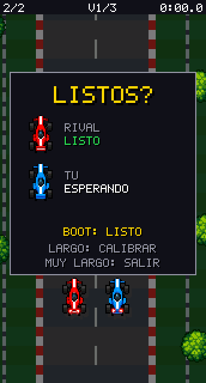 | 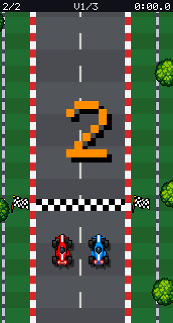 | 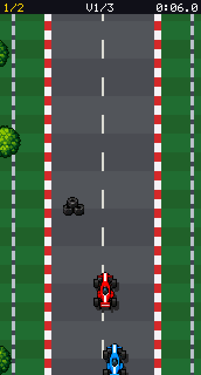 | 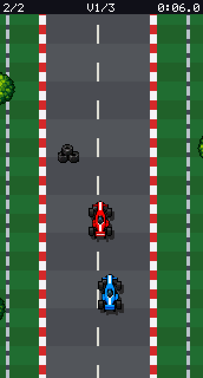 | 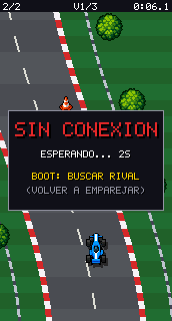 |

| Choque | Rival fuera de pantalla | Rival fuera (cliente) | Resultado | Diagnostico |
|---|---|---|---|---|
| 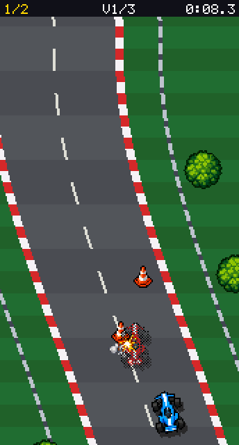 | 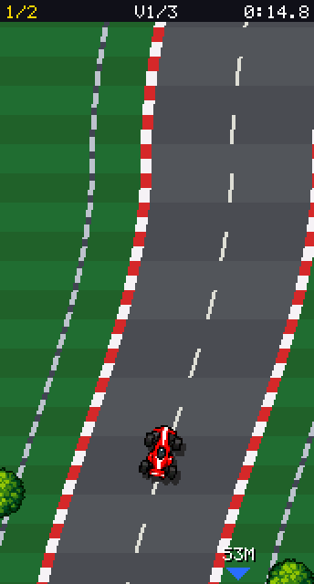 | 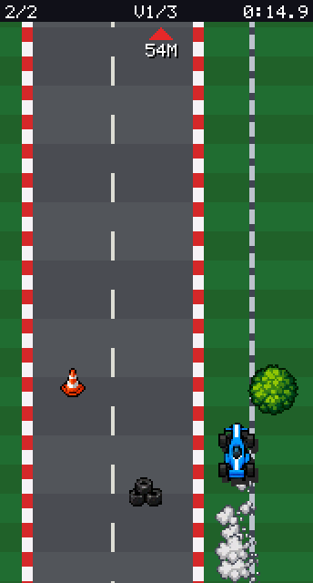 | 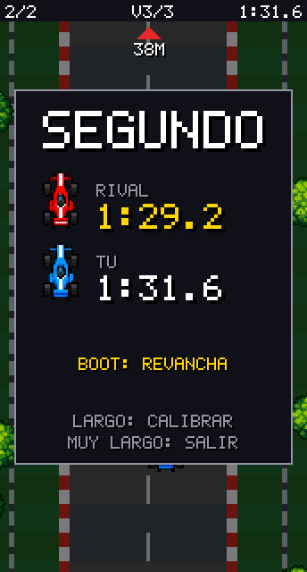 | 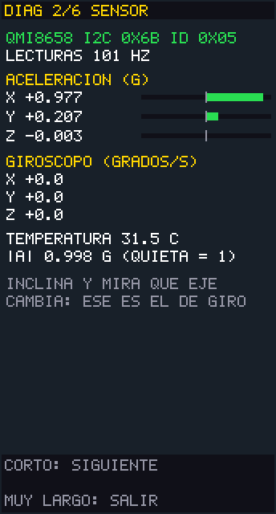 |

Las capturas salen del renderizador real del firmware ejecutado en la PC con una plataforma
simulada (ver [Pruebas en PC](#pruebas-en-pc)); no son fotos de la pantalla fisica.

---

## Estado: que esta comprobado y que no

| Que | Como | Resultado |
|---|---|---|
| Compila para la placa con PlatformIO (pioarduino 55.03.312-1, Arduino-ESP32 3.3.12, ESP-IDF 5.5.5) | ejecutado | OK, sin warnings propios. RAM estatica 58 KB (17.9 %), flash 1.0 MB |
| Compila con Arduino CLI 1.5.1 + core `esp32:esp32@3.3.12` (el mismo que usa Arduino IDE) | ejecutado | OK, sin warnings propios |
| Logica de juego, red, prediccion, pantallas y graficos | ejecutado en PC (`tools/host`), 436 verificaciones | OK |
| Conversor de sprites reproducible | ejecutado dos veces, mismo hash | OK |
| Funciona en dos placas reales | probado a mano: emparejamiento, inclinacion y carreras completas entre las dos placas | OK |

Los numeros de abajo son de la simulacion en PC. En las placas reales, el RTT, el RSSI y los
FPS se leen en el modo diagnostico (paginas RED y RENDIMIENTO); el
[plan de pruebas](#plan-de-pruebas-en-hardware) explica como.

Resultados medidos en la simulacion (dos placas con relojes distintos, 1,5-5 ms de latencia
y 3 % de perdida de paquetes):

- emparejamiento en ~100 ms desde que ambas buscan; offset de reloj estimado sin error;
- diferencia de largada entre placas: 1 ms;
- error del auto predicho del cliente frente al estado oficial del anfitrion en el mismo
  instante: promedio 0,3 px, p99 3,8 px (avance) y 2,9 px (lateral), maximo 3,8 / 11,2 px,
  sin correcciones bruscas;
- corte de 3 s en plena carrera: ambas muestran "SIN CONEXION", el rival desaparece, la
  carrera queda en pausa y se reanuda con cuenta de 2 s al volver la senal;
- tras chocar, el auto vuelve al 95 % de su velocidad en 1,85 s; nunca baja de 40 px/s;
- 30,3 FPS con el SPI simulado a 40 MHz (22,5 ms por cuadro). El tiempo de CPU de dibujo no
  se puede medir en la PC: lo informa la pagina RENDIMIENTO del diagnostico.

---

## Hardware verificado

Fuentes: [wiki oficial](https://www.waveshare.com/wiki/ESP32-S3-LCD-1.47B),
[esquematico](https://files.waveshare.com/wiki/ESP32-S3-LCD-1.47B/ESP32-S3-LCD-1.47B_schematic_diagram.pdf)
y [demos oficiales](https://files.waveshare.com/wiki/ESP32-S3-LCD-1.47B/ESP32-S3-LCD-1.47B-Demo.zip)
(Arduino `LVGL_Arduino` y ESP-IDF `ESP32-S3-LCD-1.47B-Test`). Todo esta en
[`RaceWifi/src/hw/pins.h`](RaceWifi/src/hw/pins.h).

| Recurso | Dato | Donde se verifico |
|---|---|---|
| MCU | ESP32-S3R8: 8 MB PSRAM octal, flash W25Q128 16 MB | wiki + esquematico (U4, U6) |
| Pantalla | ST7789, 172 x 320, SPI | wiki + demos |
| SPI pantalla | MOSI 45, SCLK 40, CS 42, DC 41, RST 39, luz 46 (PWM via MOSFET Q4) | wiki + esquematico + demos |
| Offset | columna +34 (RAM de 240 columnas), fila +0 | `Display_ST7789.h` (Arduino) y `ST7789.h` (IDF) |
| Init | MADCTL 00, COLMOD 05, RAMCTRL 00 E8 (little-endian), LCMCTRL 2C, inversion on | `Display_ST7789.cpp` (Arduino) |
| Reloj SPI | demo Arduino 80 MHz, demo IDF 12 MHz; aca 40 MHz | demos |
| IMU | QMI8658, I2C SDA 48 / SCL 47, 400 kHz | esquematico (tabla GPIO) + `I2C_Driver.h` |
| Direccion IMU | SDO/SA0 a GND -> 0x6B (la misma que usa el demo) | esquematico (U3) + `Gyro_QMI8658.h` |
| INT1 / INT2 IMU | GPIO13 / GPIO12 (no se usan, se lee por sondeo) | esquematico (tabla GPIO) |
| Boton | BOOT = GPIO0 con pull-up 10k, activo en bajo; RESET va a EN | esquematico (Key2) + `Button_Driver.h` |
| No usados | WS2812B en GPIO38, ADC de bateria en GPIO1, TF por SDMMC | esquematico |

No hay pantalla tactil: el unico control ademas de la inclinacion es BOOT.

**Orientacion del IMU:** ni la wiki ni los demos dicen como esta rotado el chip respecto de
la pantalla. Por eso la primera vez que arranca, despues de calibrar, el juego pide
**inclinar a la derecha**, detecta el eje que cambia (y su signo) y lo guarda en NVS. Se
puede repetir desde el modo diagnostico.

---

## Instalacion y compilacion

Se eligio **Arduino-ESP32 3.3.12** (sobre ESP-IDF 5.5.5): los demos oficiales de Waveshare
estan principalmente en Arduino y piden core >= 3.0.2. No se usan bibliotecas externas
(ni LVGL ni TFT_eSPI): el driver de pantalla, el del IMU y ESP-NOW usan APIs del propio
core / ESP-IDF, asi que no hay dependencias que fijar ademas del core.

### Opcion A: PlatformIO (recomendada; todo fijado en `platformio.ini`)

```bash
pip install -U platformio          # o la extension PlatformIO de VS Code
cd race-wifi
pio run                            # compila (la primera vez descarga la plataforma fijada)
```

`platformio.ini` fija la plataforma
`pioarduino/platform-espressif32` **55.03.312-1** (Arduino-ESP32 3.3.12 + ESP-IDF 5.5.5),
placa `esp32-s3-devkitc1-n16r8` (16 MB flash QIO, 8 MB PSRAM OPI), USB CDC al arrancar.

### Opcion B: Arduino IDE 2.x

1. Gestor de placas: instalar **esp32 by Espressif Systems, version 3.3.12** exactamente.
2. Abrir `RaceWifi/RaceWifi.ino`.
3. Menu Herramientas:

| Opcion | Valor |
|---|---|
| Placa | ESP32S3 Dev Module |
| USB CDC On Boot | Enabled |
| USB Mode | Hardware CDC and JTAG |
| CPU Frequency | 240MHz (WiFi) |
| Flash Mode | QIO 80MHz |
| Flash Size | 16MB (128Mb) |
| Partition Scheme | 16M Flash (3MB APP/9.9MB FATFS) |
| PSRAM | OPI PSRAM |
| Upload Mode | UART0 / Hardware CDC |

No hace falta instalar bibliotecas.

### Opcion C: arduino-cli

```bash
arduino-cli core install esp32:esp32@3.3.12
FQBN="esp32:esp32:esp32s3:CDCOnBoot=cdc,USBMode=hwcdc,FlashSize=16M,PSRAM=opi,PartitionScheme=app3M_fat9M_16MB,FlashMode=qio,CPUFreq=240"
arduino-cli compile --fqbn "$FQBN" RaceWifi
```

---

## Cargar el mismo firmware en las dos placas

Es **un solo firmware**: no hay que configurar quien es el jugador 1 o 2. Cuando las dos
placas se encuentran, la de MAC mayor es la anfitriona (auto rojo) y la otra la cliente
(auto azul). Las dos calculan lo mismo, asi que nunca quedan dos anfitrionas.

1. Conectar la **placa 1** por USB-C y buscar su puerto:
   ```bash
   pio device list        # en macOS aparece como /dev/cu.usbmodemXXXX
   ```
2. Cargar:
   ```bash
   pio run -t upload --upload-port /dev/cu.usbmodemXXXX
   # Arduino IDE: elegir el puerto y "Subir"
   # arduino-cli: arduino-cli upload -p /dev/cu.usbmodemXXXX --fqbn "$FQBN" RaceWifi
   ```
3. Desconectar, conectar la **placa 2** y repetir con su puerto.
4. Si la carga no conecta: mantener **BOOT**, apretar y soltar **RESET**, soltar BOOT,
   cargar de nuevo y al terminar apretar RESET.
5. Monitor serie (opcional, muestra el estado del juego y la red):
   ```bash
   pio device monitor -p /dev/cu.usbmodemXXXX
   ```

No mantener BOOT apretado al encender: GPIO0 en bajo al arrancar entra al bootloader.

---

## Como se juega

1. **Buscando rival**: las dos placas encendidas se emparejan solas en el canal 1.
2. **Calibracion**: sostener la placa como para manejar y dejarla quieta ~1 s. La primera
   vez tambien pide inclinarla a la derecha para detectar el eje.
3. **Sala**: cada jugador aprieta BOOT cuando esta listo.
4. **Cuenta 3-2-1** compartida (por reloj sincronizado) y **carrera** de 3 vueltas. El auto
   acelera solo; inclinar a izquierda/derecha lo dirige. El pasto y los choques frenan; la
   velocidad vuelve sola.
5. **Resultados** y **revancha**: los dos aprietan BOOT.

HUD: posicion (1/2), vuelta (V2/3) y tiempo. Si el rival no esta en pantalla aparece una
flecha de su color con la distancia en metros.

| Gesto en BOOT | Buscando | Sala | Carrera | Resultados | Sin conexion | Diagnostico |
|---|---|---|---|---|---|---|
| Corto (< 0,6 s) | practica solo | listo / cancelar | - | revancha | buscar rival | pagina siguiente |
| Largo (0,6-2,5 s, al soltar) | diagnostico | recalibrar | - | recalibrar | buscar rival | accion de la pagina |
| Muy largo (2,5 s) | - | salir | salir | salir | - | salir |

"Salir" envia un aviso al rival, que muestra "EL RIVAL SALIO" y espera a que su jugador
apriete BOOT para volver a emparejar. Si una placa se reinicia sin avisar, la otra detecta
su busqueda y re-empareja sola.

---

## Plan de pruebas en hardware

Hacerlas en este orden. Cada etapa depende de la anterior.

### Etapa 1: pantalla y sensor (una placa)

1. Cargar y abrir el monitor serie. Esperado:
   `[hw] lcd=1 (40000000 Hz) imu=1 addr=0x6B psram=8388608` y
   `[app] v0.1.0 imu=1 net=1 eje=-1 ...` (`eje=-1` = todavia sin detectar).
2. Pantalla de inicio: "RACE WIFI" con los dos autos, "SENSOR OK" y "ESP-NOW OK".
3. En "BUSCANDO RIVAL", pulsacion **larga** -> modo diagnostico.
4. **1/6 PANTALLA** (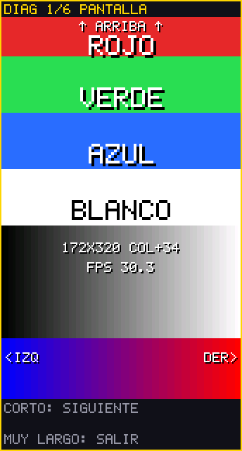):
   - borde amarillo de 1 px visible en los cuatro lados (si falta uno, el offset esta mal);
   - franjas en orden ROJO, VERDE, AZUL, BLANCO con esos colores;
   - degrade gris suave y degrade azul -> rojo;
   - "^ ARRIBA ^" arriba y "<IZQ" / "DER>" leibles (no espejados).
5. **2/6 SENSOR**: "QMI8658 I2C 0x6B ID 0x05", ~100 Hz, |A| cerca de 1,00 quieta. Inclinar a
   un lado y ver que eje cambia; girar y ver el giroscopo.
6. **4/6 CALIBRACION**: pulsacion larga -> calibra y pide inclinar a la derecha. Debe mostrar
   "EJE xx DETECTADO".
7. **3/6 DIRECCION**: el angulo sigue la inclinacion; el giro es 0 dentro de +-3 grados y
   llega a +-1 a +-25 grados. Inclinar a la derecha debe dar valores positivos y el auto
   girado a la derecha. Pulsacion larga cambia la sensibilidad (15/20/25/30/35 grados).
8. **5/6 RENDIMIENTO**: FPS ~30, CUADRO < 33000 us, SIM 60 Hz, SENSOR ~100 Hz, heap estable.
9. **6/6 RED**: MAC, canal 1, ESP-NOW OK.

Si algo falla:

| Sintoma | Ajuste en `RaceWifi/src/config.h` |
|---|---|
| Pantalla negra, log `lcd=1` | probar `LCD_SPI_HZ` 20 MHz; revisar luz (GPIO46) |
| Colores raros o con ruido | `LCD_BIG_ENDIAN 1` |
| Rojo y azul intercambiados | `LCD_MADCTL 0x08` |
| Imagen invertida 180 grados | `LCD_MADCTL 0xC0` |
| Imagen espejada | `LCD_MADCTL 0x40` |
| Falta una franja del borde | revisar `LCD_COL_OFFSET` / `LCD_ROW_OFFSET` en `hw/pins.h` |
| `imu=0` | revisar log; el driver prueba 0x6B y 0x6A |

### Etapa 2: un jugador

1. Salir del diagnostico (muy larga). En "BUSCANDO RIVAL", pulsacion **corta** -> practica.
2. Comprobar: el auto arranca solo tras 3-2-1; inclinar a la derecha lo lleva a la derecha;
   en el pasto echa humo y frena; un cono lo frena, parpadea y recupera en ~2 s sin quedar
   trabado; la vuelta cambia al cruzar la meta; a las 3 vueltas muestra el tiempo.
3. Ajustar sensibilidad si hace falta (pagina 3 del diagnostico o `TILT_MAX_DEG`).

### Etapa 3: dos placas

1. Cargar el mismo firmware en la segunda placa y pasarle la etapa 1 (sobre todo el eje).
2. Encender ambas. En ~1 s deben emparejarse; el log dice `conectado como ANFITRION` en una
   y `CLIENTE` en la otra, con la misma sesion.
3. Sala: "LISTO" de cada lado se ve en la otra placa. Con los dos listos, la cuenta 3-2-1
   debe verse a la vez en ambas.
4. Carrera: cada camara sigue a su auto; el rival se ve cuando esta cerca y la flecha con
   metros cuando no. La posicion 1/2 debe coincidir en las dos placas.
5. Choque entre autos: chispa y separacion lateral, sin quedar pegados.
6. Corte: apagar o resetear una placa en plena carrera. La otra debe mostrar
   "SIN CONEXION" sin dibujar al rival; la carrera queda en pausa. Al volver, re-empareja
   (si fue reset) o reanuda con cuenta de 2 s (si fue un corte breve).
7. Llegada: ambas muestran el mismo ganador y los mismos tiempos. Revancha con BOOT en ambas.
8. Alcance y RTT: al diagnostico solo se entra desde "BUSCANDO RIVAL", y con las dos
   prendidas se emparejan apenas arrancan. Por eso: prender **una sola**, pulsacion larga
   (~1 s, soltar antes de 2,5 s) -> diagnostico; recien ahi prender la otra (como la
   primera ya no busca, se queda en "BUSCANDO RIVAL") y hacer lo mismo. En las dos ir a la
   pagina 6 y pulsacion larga para que se emparejen ahi. El RTT lo mide la placa que dice
   ROL CLIENTE (en la anfitriona figura 0). Alejarlas y mirar RSSI, RTT, perdidas y
   paquetes viejos.

### Medir y ajustar

Los valores iniciales son los pedidos: simulacion 60 Hz, dibujo 30 FPS y red 20 Hz
(`SIM_HZ`, `RENDER_FPS`, `NET_HZ`). Con las medidas de las paginas 5 y 6:

- Si CUADRO se acerca a 33 ms, subir `LCD_SPI_HZ` a 80 MHz (el valor del demo Arduino
  oficial) y comprobar que la imagen siga limpia.
- Si el rival se ve a los saltos con buena senal, subir `RIVAL_INTERP_MS` (70 -> 100).
- Si el auto propio corrige posicion a menudo, subir `NET_HZ` a 30 (los paquetes son de 16 y
  68 bytes; ESP-NOW lo soporta de sobra).
- Si hay interferencia en el canal 1, cambiar `ESPNOW_CHANNEL` (1, 6 u 11) en **ambas**.

---

## Ajustes (`RaceWifi/src/config.h`)

| Grupo | Parametros |
|---|---|
| Pantalla | `LCD_SPI_HZ`, `LCD_MADCTL`, `LCD_BIG_ENDIAN`, `LCD_BACKLIGHT_PCT` |
| Ritmos | `SIM_HZ` (fijo en 60), `RENDER_FPS`, `NET_HZ`, `IMU_HZ` |
| Inclinacion | `TILT_DEADZONE_DEG` (3), `TILT_MAX_DEG` (25), `TILT_FILTER_MS` (70), calibracion |
| Red | `ESPNOW_CHANNEL`, tiempos de busqueda / perdida, interpolacion y reconciliacion |
| Carrera | `RACE_LAPS`, cuentas regresivas, espera al segundo |
| Fisica | velocidad maxima, aceleracion, pasto, choques, penalizaciones |

La sensibilidad elegida en el diagnostico y el eje detectado se guardan en NVS (espacio
`racewifi`). Para borrarlos: `pio run -t erase` y volver a cargar.

---

## Arquitectura

```
RaceWifi/
  RaceWifi.ino              setup()/loop(): crea la plataforma ESP32 y el App
  src/config.h              todos los parametros ajustables
  src/hw/pins.h             pines verificados
  src/platform/             interfaz Platform + implementacion ESP32 (NVS, log, heap)
  src/display/              driver ST7789 (SPI+DMA), lista de dibujo y rasterizador por tiras, fuente 5x7
  src/assets/               sprites RGB565 + mascara (generados)
  src/sensor/               QMI8658 por I2C con tarea propia a 100 Hz
  src/input/                boton (antirrebote, gestos), inclinacion, calibracion, deteccion de eje
  src/game/                 pista, fisica y reglas de carrera, humo/chispas
  src/net/                  protocolo, enlace (emparejamiento, sesion, reloj), suavizado, ESP-NOW
  src/app/                  maquina de estados, pantallas y diagnostico
tools/
  sprite_convert.py         lamina -> sprites, previsualizaciones, manifiesto y codigo C++
  gen_font.py               fuente 5x7 propia -> font5x7.h
  host/                     plataforma simulada y pruebas en PC
assets/
  source/spritesheet.png    lamina original
  sprites/*.png             sprites a tamano de juego (alfa binaria); hires/ = recortes originales
  preview/                  hoja a tamano real y x4 sobre asfalto y pasto
  manifest.json             tamanos, pivotes, escalas y recortes
```

Todo lo de `app`, `game`, `net` (salvo `espnow_transport`), `input`, `display` (salvo
`lcd_st7789`) y `assets` es portable: no incluye Arduino ni ESP-IDF y es lo que corren las
pruebas en PC.

**Loop sin bloqueos.** `loop()` procesa la cola de red, avanza la simulacion a paso fijo de
60 Hz (con recuperacion si se atrasa), envia la red a 20 Hz (y de inmediato ante cambios) y
dibuja. El dibujo arma una lista de elementos por cuadro y la rasteriza en 10 tiras de
172 x 32 sobre dos buffers DMA: mientras una tira sale por SPI, el loop sigue y dibuja la
siguiente. Las unicas asignaciones dinamicas son los dos buffers al arrancar; los unicos
`delay` estan en la inicializacion del hardware.

**Pista.** Vuelta de 6400 px definida por puntos de control con interpolacion suave
(tabla precalculada). Asfalto, pianos rojo/blanco, linea punteada, pasto a franjas,
guardarrail y meta a cuadros se dibujan por fila con primitivas; conos, neumaticos, arboles
y banderas son sprites. Posicion = distancia total recorrida.

**Inclinacion.** Angulo del eje lateral respecto del plano horizontal menos el neutro
calibrado, filtro paso bajo de 70 ms, zona muerta 3 grados, saturacion 25 grados. Funciona
con la placa acostada o parada.

### Red (ESP-NOW)

| Paquete | Sentido | Bytes | Contenido |
|---|---|---|---|
| HELLO | broadcast, 4 Hz | 18 | busco rival, canal |
| PAIR_REQ / PAIR_ACK | anfitrion <-> cliente | 18 / 12 | sesion aleatoria de 16 bits |
| PING / PONG | cliente <-> anfitrion | 16 / 24 | sincronizacion de reloj tipo NTP |
| INPUT | cliente -> anfitrion, 20 Hz | 16 | giro, listo, revancha |
| STATE | anfitrion -> cliente, 20 Hz | 68 | fase, largada, tiempo, ambos autos, ganador |
| BYE | ambos | 12 | salida voluntaria |

Todos llevan magia, version, **sesion, secuencia y reloj del emisor**. Se descartan paquetes
de otra sesion, con secuencia vieja o que esperaron mas de 300 ms en la cola. Las callbacks
de ESP-NOW solo copian a una cola FreeRTOS (recepcion) o suman contadores (envio).

- **Anfitrion autoritativo**: simula los dos autos con el ultimo control del cliente, decide
  colisiones, vueltas, llegada y ganador.
- **Cliente**: predice su propio auto con la misma fisica y lo reconcilia en forma suave
  contra el estado oficial *del mismo instante* (historial de 1 s + reloj sincronizado);
  solo corrige de golpe si el error supera 64 / 32 px. El rival se dibuja interpolado
  70 ms atras y adelantado segun su velocidad.
- **Perdida**: sin paquetes 350 ms el rival se ve translucido; a los 2 s se marca la conexion
  perdida, el rival desaparece y la carrera se pausa.

---

## Graficos

```bash
python3 -m venv tools/.venv
tools/.venv/bin/pip install -r tools/requirements.txt   # Pillow 12.0.0, numpy 2.3.4
tools/.venv/bin/python tools/sprite_convert.py
tools/.venv/bin/python tools/gen_font.py
```

El conversor detecta las canaletas vacias de la lamina, recorta cada dibujo por su caja real
(las celdas no estan centradas: hay desvios de hasta 31 px), incluye particulas sueltas de
humo y chispa, verifica que nada toque el borde de su celda ni del lienzo y que las variantes
de giro esten inclinadas hacia el lado correcto. Reduce con vecino mas cercano: los autos a
~21 x 32 en lienzo de 22 x 34 (rectos) y 26 x 34 (girados), misma escala y pivote en el
centro. Exporta RGB565 con mascara de 1 bit (20,5 KB en flash para los 16 sprites; la lamina
no se usa en el juego). Ver `assets/manifest.json` y `assets/preview/preview_4x.png`.

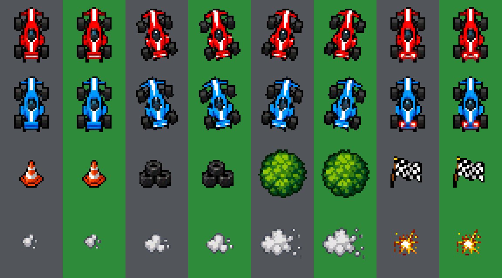

---

## Pruebas en PC

```bash
tools/host/run_host_tests.sh      # requiere un compilador C++17 (clang o gcc)
```

Compila el codigo portable del firmware con una plataforma simulada y verifica: pista
cerrada y siempre transitable, inclinacion (zona muerta, saturacion, filtro), calibracion y
deteccion de eje, gestos del boton, protocolo, que ningun choque deje el auto trabado, y
escenarios completos: dos placas con relojes distintos, latencia y 3 % de perdida
(emparejamiento, calibracion, cuenta compartida, carrera completa, corte de 3 s, revancha,
salida voluntaria, re-emparejamiento), una placa que se reinicia en carrera, tres placas
buscando a la vez (se forma un solo par con roles distintos), practica solo y diagnostico.
Deja capturas en `build/host_out/`.

---

## Limitaciones conocidas

- Sin pin TE: puede verse algo de tearing en movimiento rapido.
- La prediccion del cliente no puede anticipar los choques entre autos (los decide el
  anfitrion): se corrigen en 50-100 ms.
- Canal ESP-NOW fijo por configuracion (no hay busqueda de canal libre).
- Sin sonido ni extras, por pedido.
